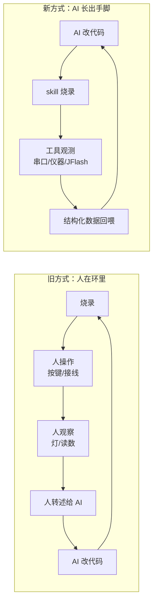
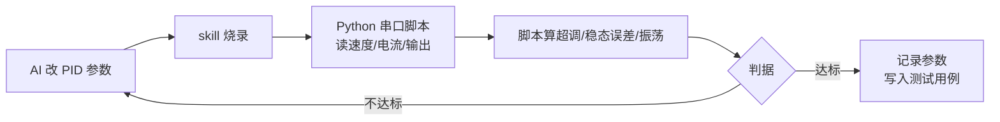
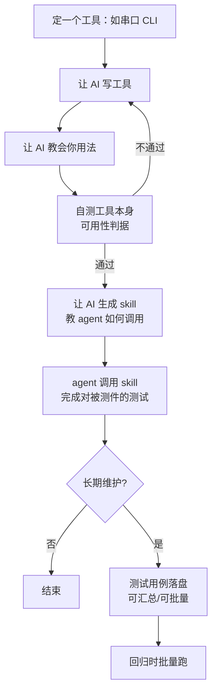
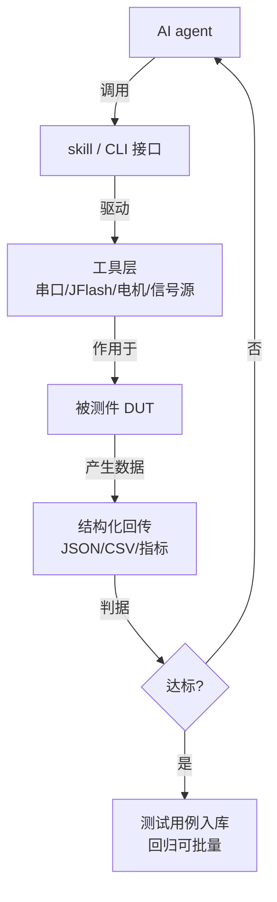

# 工欲善其事，必先利其器——后 AI 时代的嵌入式调试思考与实践

## 一、问题：人是整条链路里最慢的一环

后 AI 时代，agent 工具层出不穷。我们已经可以这样干活：让 A 写代码，让 B 做审核，再烧录、再测试。但随着工作推进，我们越来越清楚地发现——**人是整个环节中最慢的一环**。如何把人从这条链路里去掉，是我这段时间思考最多的问题。

实践中，写代码、烧录代码、提交上传，这些动作都可以靠 skill 跑通。唯独**调试**替代不掉。原因有两层：

一是嵌入式的代码并不完全依赖于软件。它可能接线错误，可能端口配错，可能供电不稳——这些事不体现在代码里，却直接决定成败。软件层面的 agent 再强，也摸不到那根接错的杜邦线。

二是传统调试方式必须有人参与。可能是人去输入——按一下按键、拨一下开关；也可能是人去观察输出——看哪个灯亮、看屏幕读数。这些动作把人焊死在环路里。

所以，**如何把「调试」这个环节整合给 AI，让它自行判断现象**，就成了关键。

## 二、思路：让 AI 长出手和脚

先说清楚我们不打算做什么：不是给 AI 接一个摄像头，让它跑 poll 循环判断现象、改代码、烧录、再看。那是拿人眼换机器眼，环路照样是断的，而且更慢、更贵。

我们的做法是**用一系列小工具补上 AI 的感知与动作**——让 AI 长出手和脚。



手和脚具体长在哪？看几个真实场景。

### 场景一：调 PID 电机串环

一个电机的串环——速度环下面串了电流环。

**旧方式**：单片机把数据从串口打出来，人盯屏幕，把看到的曲线复制粘贴给 AI，AI 改代码，人再烧录，人再看。每一圈都要人转述一次。

**新方式**：串口照旧打印数据，但让 AI 自己写一个 Python 脚本来做串口读写。脚本按固定格式收数、解析、算指标（超调、稳态误差、振荡频率），直接把结论回喂给 AI。于是这条环路闭上了：AI 改代码 → skill 烧录 → 脚本取数 → 脚本判据 → AI 再改。



### 场景二：调 FFT

典型如振动分析或音调检测——要验证 FFT 的峰点频率、幅值精度、频率分辨率。

**旧方式**：把采样点或频谱打到串口，人眼看波形、肉眼对峰，或者把一大段数据粘给 AI。慢，而且人眼判精度本来就不可靠。

**新方式**：给 AI 两件工具。

- **信号注入**：DAC 输出已知频率的正弦，或信号源给定输入；若是 I2S 麦克风，则播放已知音调。
- **数据采集与比对**：把 FFT 结果（峰值频率、峰值幅值、指定 bin 的能量）按结构化格式从串口吐出，AI 写一个比对脚本，拿实测值跟理论值比，输出误差和 pass/fail。

这样 AI 可以自主判断「1 kHz 输入在 bin 42 上的幅值误差是 3.2%，超差了」，而不是等人说「看着不太对」。循环次数可以翻几十倍，人只在最后看结论。

### 场景三：调摄像头

典型如视觉循迹、目标检测——要验证「线在哪」「框对不对」「阈值合不合适」。

**旧方式**：人盯着显示器看识别效果，口头描述给 AI：「好像偏左了」「光线一变就丢」。描述是模糊的，AI 只能猜。

**新方式**：给 AI 三件工具。

- **中间量导出**：固件加一条调试指令，把处理结果和关键中间量按 JSON 从串口吐出——线位置、置信度、阈值、边缘坐标。让 AI 不只看到「结果不对」，还能看到「在哪一步开始不对」。
- **已知场景测试**：用测试图卡或定位工装，把被测物摆到已知位置。若被测物在车上，还可以让电机把车开到标定位——电机本身就是一个动作工具。
- **比对脚本**：对每个已知场景，比对输出与期望值，给出误差表。

于是「光线一变就丢」这种话，变成了「照度 200 lux 时位置误差 4 px，500 lux 时 1 px」——AI 拿到的是数字，不是印象。

### 场景四：让 agent 调试器

我们甚至可以让 agent 直接调用调试工具，例如 JFlash / J-Link，把代码里的变量读出来，自行核对代码行为与预期是否一致。这等于给 AI 装上了「眼睛」，可以直接看内存、看寄存器，不必再靠人转述。

> 工具不必大，但必须**可观测、可调用、可判定**。这是「手脚」的三条硬指标。

## 三、实践：先造工具，再写代码

那具体怎么干？比较反常的是，这次我们**不先确保代码的完整性**。我们要先确保一件事：**给到 AI 的工具是可用的**。

流程是这样的：



以串口工具为例：

1. **设计工具**：要求它从命令行可调用——`serial_tool.py --port COM3 --send "01 03 00 00 00 02" --expect "01 03 04 ..." --timeout 200`。
2. **教会用法**：让 AI 写完之后，**反过来让它教你怎么用**。它写得出来却讲不清，说明接口设计有问题。
3. **自测**：工具自己得先过一遍——能开关串口、能发能收、超时能报错、参数不对能拒绝。
4. **生成 skill**：自测通过后，让 AI 生成一份 skill，把调用方式、参数约定、输出格式、失败语义写清楚，教会 agent 如何使用。
5. **agent 干活**：agent 调用 skill，完成对被测件的完整测试。

代码若需长期维护，测试用例就必须留存。让 AI 把散落的用例汇总成库，或者干脆做成可批量调用的形式。怎么做？还是**写工具**——把测试用例做成**可配置的项**，由脚本读取后发送、采集、比对。输入格式和输出格式都规定死，机器才可判。

## 四、用例：TTL 转 RS485 测试工具

举个具体例子。我们手上有一个 TTL 转 RS485 的工具，对面挂一台 Modbus RTU 的电表。

旧方式：人打开串口助手，手动发一帧 `01 03 00 00 00 02 C4 0B`，肉眼对回文，抄下来，贴给 AI。改一版固件就再抄一遍。

新方式：把这个动作做成工具 + 用例配置。

**用例配置（YAML）**：

```yaml
- name: 读电压
  send: "01 03 00 00 00 02 C4 0B"
  expect:
    prefix: "01 03 04"
    bytes: 7          # 从站地址+功能码+字节数+数据+CRC
  timeout_ms: 200

- name: 读电流
  send: "01 03 00 02 00 02 65 CB"
  expect:
    prefix: "01 03 04"
    range: [0.0, 60.0]   # 解析后数值落在合理区间
  timeout_ms: 200

- name: 异常帧·错误功能码
  send: "01 08 00 00 00 02 XX XX"
  expect:
    prefix: "01 88"      # 异常响应
  timeout_ms: 200
```

**工具行为**：

- 逐条读用例，构造报文（CRC 可由工具算），通过 TTL→RS485 发出；
- 收响应，按 `expect` 规则判：前缀匹配、长度匹配、数值区间、异常码；
- 输出结构化结果：`{case, pass, send, recv, elapsed_ms, error}`。

**AI 拿到的东西**：一整份 JSON 结果，而不是「我发了，好像没回」。

**收益**：
- 用例进仓库，长期维护；
- 回归时 `python rs485_tool.py --suite cases.yaml` 一次跑完；
- 新固件改完，AI 自己重跑套件，自己判断有没有退化。

## 五、核心：给 AI 可调用的工具，和能用的接口

总而言之，我们的核心思路是：

> **给 AI 提供它能调用的工具。工具已有就用现成的；没有，就为它造。但只有工具还不够——最好还要配上清晰的接口。**



三层要求，缺一层就退化回「人在环里」：

| 层 | 要求 | 反例 |
|----|------|------|
| 工具 | 可观测、可动作 | 只能在 IDE 里点按钮的 GUI |
| 接口 | 命令行/HTTP 可调用，参数与输出格式固定 | 只能人眼看的串口助手 |
| 判据 | 输出结构化、可机判 pass/fail | 「看着好像对」 |

工具是手和脚，接口是神经，判据是反射弧。三者齐了，AI 才真正长出手脚。

最后补一句：这条路不是为了炫技，是因为**人是整条链路里最慢的一环**。把人从调试环里挪到看结论的位置，把重复劳动交给工具，这才是后 AI 时代嵌入式该有的干活方式。

---

*本文是《AI 时代嵌入式开发教程》第 0 章导读。*
